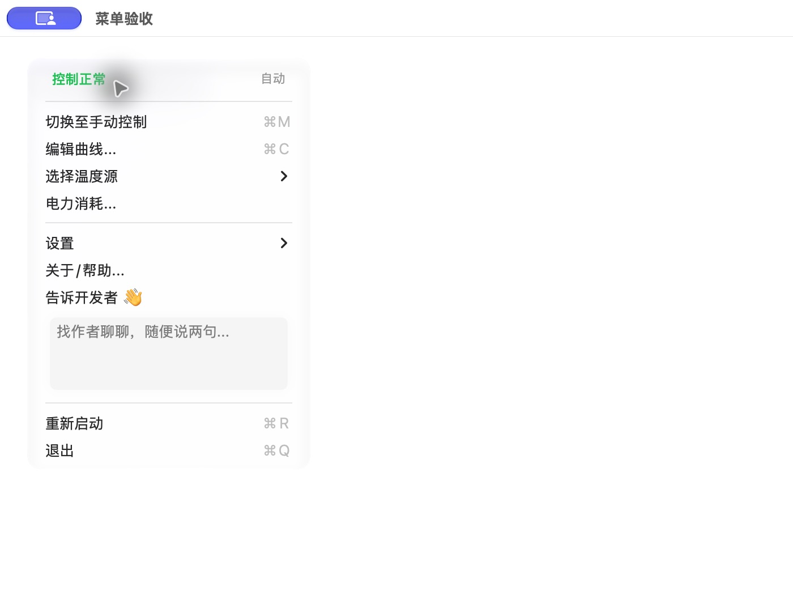

# 恢复反馈邀请与说明状态时间：Beta68

2026-10-13。维护者明确确认：主菜单“告诉开发者”下面的文本框外观，是主动邀请用户反馈的产品设计。点击后打开独立反馈窗口是预期行为。先前把它当成冗余入口删除，是本轮UI梳理中的误判，已经恢复。

## 当前行为

- 保留原邀请文案、圆角文本框外观、留白和不可在菜单内直接编辑的语义。整个框均可点击，进入独立反馈窗口；标题入口也继续保留。宽度对齐当前菜单，未把邀请框缩成普通菜单文字。
- 邀请框上使用不绘制自身的原生按钮处理点击，先退出菜单追踪再打开反馈窗口。中文和英文的实际控件点击均已打开反馈窗口，正文获得焦点；没有提交真实反馈。
- 顶部显示“控制正常 · 自动/手动”。12分钟前这样的数字不再与正常状态并排，时间保留在提示文字里，明确命名为“最近一次状态记录”。

[点击后进入反馈窗口](assets/ui-validation-68/invitation-opens-feedback-zh.jpg)、[英文深色手动菜单](assets/ui-validation-68/menu-manual-en-dark.jpg)、[英文反馈窗口](assets/ui-validation-68/invitation-opens-feedback-en.jpg)。

## 时间的实际含义

AppDelegate.updateControlStatus按mode和detail组成签名，普通更新在签名相同时直接返回。因此正常状态没有改变时，控温循环持续运行也不会逐次重写recordedAt。启动及交还系统等force路径允许强制记录。这个时间标记最近一次状态记录，不能把它当成最近一次传感器采样或正常检查的时间。

本轮保留记录规则、force语义、控温循环与配置。只修正呈现与说明，没有为了让显示时间新鲜而改变记录频率。

## 验收与发布

- Release构建及原生控制器回归通过。菜单夹具使用12分钟前的记录，检查当前状态/模式、提示中的记录时间、不可编辑邀请框及其按钮覆盖区域、全部13个菜单命令可达、同一菜单对象原地刷新；最终英文证据在 `packaging/pkg/output/ui-validation-68/menu-behavior.json`。
- 实际查看中文浅色与英文深色，实际点击邀请控件进入独立反馈窗口。截图来自独立偏好/配置和模拟遥测夹具，不运行AppDelegate控温、不替换用户应用、不发送真实反馈。工具的任意菜单坐标点击接口不支持该自定义区域，原生按钮控件点击已完成正向验证。
- 对照67 source-record：仅MenuBarManager的反馈邀请/点击路径、状态呈现改变；其外代码和其他产品源文件及PKG脚本保持原样，见 `packaging/pkg/output/beta-68/protected-invariants.json`。67的完成勾大小、圆角填充与动效继续保留。
- Beta68独立PKG SHA256 `aca31c48e7e2b1ed820748d031ab74c065dd2d935765e4d2179366c1fcf89ed2`。Production `9b2ca0fa-eb39-417d-a8f5-1d25fcb6b665` 成功；线上PKG重下载与本地逐字节一致，三份feed JSON/no-store，保留58个非Beta-feed旧资产及相同后端/运行绑定，HEAD官网下载仍52。证据见 `packaging/pkg/output/beta-68/verification.json`。正式/旧线路保持52，不进行正式GitHub发布或源码提交/推送。

此邀请框是后续UI改动的明确保留项。精简应保留产品意图，不能仅按是否与另一入口通往同一页面判断其价值。
