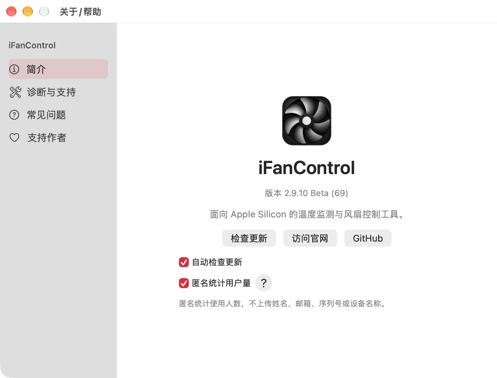

# 关于/帮助侧栏与官网入口：Beta69

2026-10-13。按维护者的截图反馈，放大左侧导航文字，缩小选择区域，在简介页新增访问官网按钮。

- 导航文字12→14点，选中项继续使用medium字重；图标同步适度放大。
- 侧栏176→164点，选中背景152×30→140×28点；正文获得额外空间，窗口保持700×500。
- 英文支持作者使用可完整显示的“Support Author”，辅助功能标签保留“Support the Author”。
- 原生“访问官网 / Visit Website”按钮位于检查更新与GitHub之间，使用系统默认浏览器打开项目已有官方域名 `https://ifancontrol.puremilkchun.top`。

[英文深色简介](assets/ui-validation-69/help-en-dark.jpg)、[中文支持页](assets/ui-validation-69/help-zh-diagnostics.jpg)、[英文开发者页](assets/ui-validation-69/help-en-developer.jpg)。截图来自隔离偏好/配置的原生控制器夹具。

Release构建与原生控制器回归通过。实际点击官网按钮记录完整目标URL，官网HEAD返回200；实际点击App图标10次进入开发者页，新增导航完整显示。中英文深浅色实际渲染已检查，没有截断导航或简介按钮。

对照68，源代码修改仅在HelpWindowController内；其他源文件、PKG脚本、反馈邀请框、控制状态语义与完成提示精确保持，见 `packaging/pkg/output/beta-69/protected-invariants.json`。没有运行真实控温、替换用户安装的应用、发送反馈或执行PKG安装。

Beta69独立发布，正式/旧线路及官网下载保持2.9.9/build52。最终云端部署、公网PKG与SHA256、59个非Beta-feed资产及后端不变证据见 `packaging/pkg/output/beta-69/verification.json`。实际安装与重启由维护者通过Beta更新继续验收。
