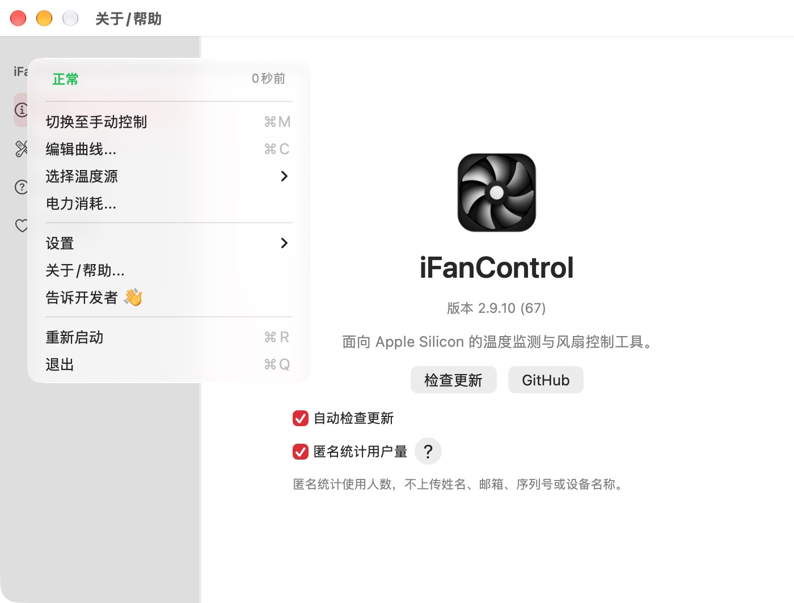

# 主菜单与完成提示：Beta67

此文件保留67的历史交付。维护者随后明确反馈邀请框必须保留、正常状态旁的记录时间造成歧义；当前修正见 [Beta68反馈邀请与状态文案](3.0-ui-feedback-intent.md)。

2026-10-13。维护者明确“下拉框繁杂”指菜单栏展开的主菜单。本轮只修改主菜单的呈现及完成提示；曾制作的信息栏设置简化试稿已撤回，设置窗口恢复为66的原样。

## 主菜单

- 将原来的双列状态卡片收为一行“控制状态 + 刷新时间”，保留原状态颜色、告警文字与时间规则。详情放在提示文字中。
- 控制模式、手动转速（仅手动时出现）、曲线、温度源、功耗保持直接可用。开机启动、展示设置、安全转速、语言集中到“设置”子菜单。
- 硬件信息移入设置子菜单，当前温度源移入温度源子菜单；去掉重复分组标题和多余分隔线。帮助、反馈、重启及退出保留。
- 菜单仍一次构建、动态原地更新，不在每个刷新周期重建。所有操作selector、控温/读取/计时器/状态栏渲染、状态映射及配置语义保持。

[此前英文菜单](assets/ui-validation-66/menu-en-dark.jpg) → [本轮英文手动模式](assets/ui-validation-67/menu-manual-en-dark.jpg)。

[设置子菜单](assets/ui-validation-67/menu-settings-zh-light.jpg)、[温度源子菜单](assets/ui-validation-67/menu-temperature-en-dark.jpg)。

## 完成提示

移除叠加popover材质的背景，采用单一系统颜色圆角填充与原生窗口阴影；透明角部不再叠加材质亮边。完成勾从24×24增大到36×36点，提示窗口从340×72调整为360×80点；保留0.24秒描边、减少动态效果的静态分支、非阻断显示与1.8秒自动消失。

[浅色完成提示](assets/ui-validation-67/notice-en-light.jpg)、[中文深色](assets/ui-validation-67/notice-zh-dark.jpg)。

原生视图直接渲染的RGBA PNG经AppKit读取核对：720×160像素、四角alpha均为0；深色圆弧236个半透明抗锯齿像素中，亮色像素为0。实际行布局中完成勾为36×36点。证据：`packaging/pkg/output/ui-validation-67/notice-edge-verification.json`、`notice-dark.json`、`check_notice_edges.swift`。浅色圆弧使用浅色背景正常抗锯齿，未以“无任何亮像素”判断浅色结果。

## 验证与交付

- Release构建通过；原生控制器回归通过，代码保护核对确认其相关控制器恢复/保留。最终菜单夹具实际运行13个命令selector可达、手动转速可见性、语言选中态、同一菜单对象原地刷新断言后展示菜单。原生中文浅色、英文深色/手动模式与子菜单均已实际查看。
- 由66原生夹具移除模拟替代，还原出的原始main.swift与66记录的SHA256完全吻合；再比较67，所有MenuBarManager之外的代码逐字相同。MenuBarManager的操作方法、状态映射、轮询、状态栏渲染亦逐字相同。其余产品源文件和PKG脚本仅InteractionNotice变化，见 `packaging/pkg/output/beta-67/protected-invariants.json`。
- 夹具使用独立偏好/配置与模拟遥测，不运行AppDelegate或控温循环，不安装、不替换 `/Applications`、不发送反馈。完成提示通过隔离版本回执触发；真实更新/系统Installer安装仍由维护者体验。
- 本地与线上 **2.9.10 Beta / build67** PKG SHA256：`18fba494216e4e4ebb85223ea4ea9f5d9f250cfe64a257706083f59daf836e92`。公网包重新下载逐字节核对通过，包展开、签名、脚本和sudoers检查沿用构建器验证。
- Production `62d8bf39-9351-4f9f-8d1b-89e91ec69651`，前一66部署保留。仅Beta feed和独立67 PKG变化，原57个非Beta-feed资产、后端bundle/路由及运行绑定保持。三份feed JSON/no-store，正式/旧feed及HEAD `/download` 仍52。见 `packaging/pkg/output/beta-67/verification.json`。

开启Beta后检查更新即可从66升级67。下一build大于67；没有正式发布、提交/推送或整理历史文件。后续主菜单的低频设置请从“设置”进入。
