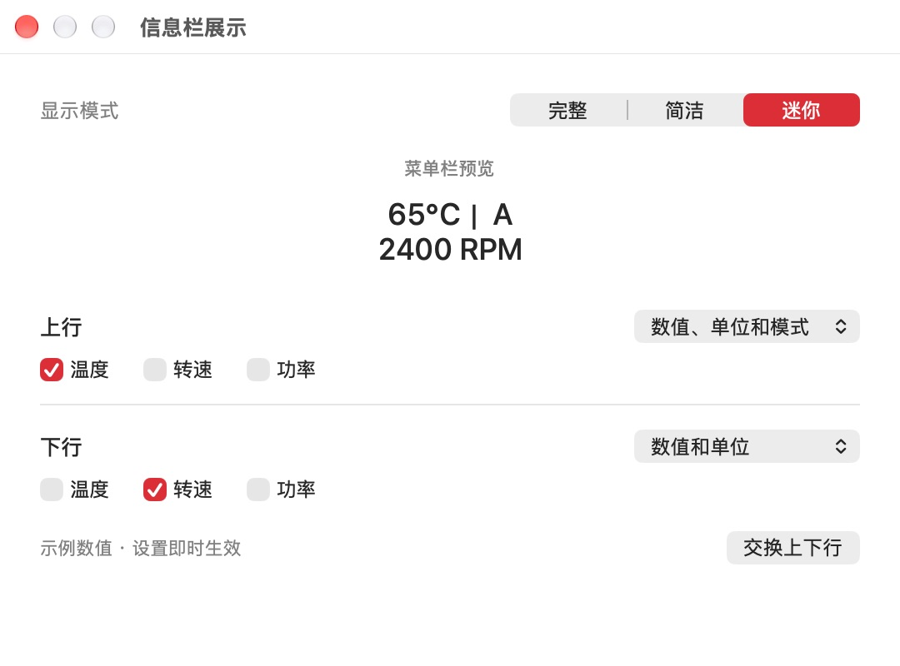
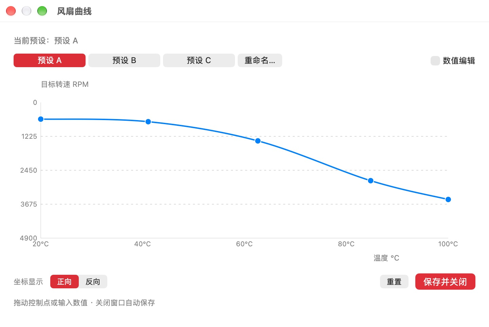

# 原生 UI 第二轮：Beta 66

本文件保留66的历史设计与验收。当前主菜单和完成提示的两项修正已发布Beta67，见 [本轮记录](3.0-ui-menu-notice.md)。信息栏设置没有采用之后的简化试稿，仍维持本文件的66设计。

2026-10-13。第一轮完成了状态反馈和可用性改善，但维护者认为视觉效果比原版差。本轮重新检查构图、比例、信息层级和操作密度，并保留已经验证的行为。审美是否符合维护者预期仍需实际使用评价；行为测试通过不等于好看。

## 设计依据

已安装并阅读 [redesign-existing-projects](https://github.com/Leonxlnx/taste-skill/tree/main/skills/redesign-skill) 和 [macos-app-design](https://github.com/petekp/agent-skills/tree/main/skills/macos-app-design)，包括后者的原生设计参考。前者用于先诊断再修改，后者用于约束原生组件、字体、系统颜色与菜单栏工具的窗口模型。没有把网页营销布局、装饰纹理或网页动画库搬进 App。

设计方向：菜单栏工具的辅助窗口应紧凑、目的明确。主要读数或编辑对象优先；说明弱化但保持可读；次要编辑按需展开。按钮遵循既有生效时机，避免为了统一外观改变使用语义。所有图像均为实际 AppKit 渲染，非效果图。

## 具体变化与前后对照

| 界面 | 本轮变化 | 第一轮 64/65 | 本轮 66 |
| --- | --- | --- | --- |
| 显示设置 | 模式分段选择；两行内容与样式横向组织；保留最终预览与交换 | [之前](assets/ui-validation-64/display-zh-light.jpg) | [中文浅色](assets/ui-validation-66/display-zh-light.jpg)、[英文深色](assets/ui-validation-66/display-en-dark.jpg) |
| 曲线编辑 | 默认突出曲线；数值面板按需展开，⌘⌥I；减少坐标网格与按钮的视觉竞争 | [之前](assets/ui-validation-64/curve-zh-light.jpg) | [默认](assets/ui-validation-66/curve-zh-light.jpg)、[数值面板](assets/ui-validation-66/curve-inspector-zh-light.jpg)、[英文深色](assets/ui-validation-66/curve-inspector-en-dark.jpg) |
| 调速 | 数字与单位分级；说明、范围、调节方式与主要动作形成稳定顺序 | [之前](assets/ui-validation-64/speed-en-dark.jpg) | [中文](assets/ui-validation-66/speed-zh-light.jpg)、[英文分档](assets/ui-validation-66/speed-stepped-en-dark.jpg)、[应用成功](assets/ui-validation-66/speed-applied-zh-light.jpg) |
| 安全转速 | 沿用相同读数与操作排布；说明对应原110℃规则 | — | [中文](assets/ui-validation-66/safety-zh-light.jpg)、[英文深色](assets/ui-validation-66/safety-en-dark.jpg) |
| 功耗 | 总功耗优先；组件功耗对齐；采样状态与估算说明退到辅助层级 | [之前](assets/ui-validation-64/power-zh-light.jpg) | [数据](assets/ui-validation-66/power-zh-light.jpg)、[不支持](assets/ui-validation-66/power-unsupported-zh-light.jpg) |
| 帮助 | 窗口缩至700×500；侧栏176；只布局当前页面，避免隐藏页面撑大窗口；子页移除重复图标页头 | [之前](assets/ui-validation-64/help-zh-light.jpg) | [简介](assets/ui-validation-66/overview-zh-light.jpg)、[支持](assets/ui-validation-66/support-en-dark.jpg)、[FAQ](assets/ui-validation-66/faq-en-dark.jpg)、[支持作者](assets/ui-validation-66/donation-en-dark.jpg) |
| 反馈 | 原生输入区；关闭与发送置于右下；⌘↩提示独立；“关闭”准确描述窗口动作 | — | [中文](assets/ui-validation-66/feedback-zh-light.jpg)、[隔离发送成功](assets/ui-validation-66/feedback-delivered-en-dark.jpg) |
| 更新 | 缩短窗口；标题、说明、字节进度与动作层级清晰；成功提示使用0.24秒描边勾，减少动态效果时静态显示 | [之前](assets/ui-validation-64/update-known-total.jpg) | [下载](assets/ui-validation-66/update-progress-en-dark.jpg)、[未知总量](assets/ui-validation-66/update-unknown-total-zh-light.jpg)、[失败恢复](assets/ui-validation-66/update-failed-en-dark.jpg)、[完成提示](assets/ui-validation-66/update-complete-en-dark.jpg) |

## 验证与保留边界

- Release构建、原生控制器回归及真实UpdateService隔离测试通过。日志：`packaging/pkg/output/ui-validation-66/{release-build,ui-tests,updater-tests}.log`。回归包括显示来源顺序/最后一个来源/交换、曲线精度/范围/无效输入/保存失败、反馈失败草稿与重发、功耗状态与计时器。
- 实际查看中文浅色、英文深色的主要窗口，以及功耗不支持、分档调速、反馈成功、已知/未知下载总量、打开安装器失败与重试、取消下载、安装版本回执提示。九次图标点击仍隐藏，第十次进入开发者页且Beta未勾选，见[实际截图](assets/ui-validation-66/developer-en-dark.jpg)。未执行完整VoiceOver会话或修改系统减少动态效果设置。
- 隔离应用使用独立偏好/配置、模拟遥测与网络；更新传输使用真实PKG字节及正确SHA256。外部打开安装器与退出被替代，反馈不发送到生产服务器，不启动控温循环。
- 对照65源快照，硬件读取、遥测、安全规则、FanManager、ConfigManager、更新服务/协议/下载器/偏好、AppDelegate生命周期、反馈传输、Config字段及PKG脚本保持原样。记录：`packaging/pkg/output/visual-refinement-66/protected-invariants.json`。曲线绘图样式与窗口布局改变，控制算法与配置契约保留。
- 曲线数值面板默认隐藏，但输入无效而阻止关闭时会自动展开，避免错误字段不可见；面板偏好独立于控制配置。手动调速及安全转速仍需显式应用，展示偏好仍即时生效，曲线仍关闭保存。
- 完成提示仍只在运行版本达到记录的目标build后显示。App内勾与系统Installer完成勾是两个位置；本轮看到的是隔离应用的版本回执提示，未执行真实安装、重演系统Installer完成页或替换用户 `/Applications` 应用。PKG资源及脚本沿用65，并经构建器展开验证。

## 交付与人工验收

已发布 **2.9.10 Beta / build66**，安装包[独立下载](https://ifan-59w.pages.dev/iFanControl-beta-2.9.10-66.pkg?build=66)。本地包：`packaging/pkg/output/beta-66/iFanControl-2.9.10.pkg`；SHA256 `202343b95ef5938d1f3508a05d05843a92d03da3efd6f90db5c9427803c24057`。沿用现有ad-hoc应用签名及未公证PKG方式。

Production `91662a64-a4c5-41ca-9a1a-7b1109678715`，前一版 `61e8903f-d65f-48fd-b6ad-15dfbbf52431` 保留。只更新Beta feed并新增独立66包；其余56个资产哈希及相同后端bundle、路由、运行绑定保留。线上包重新下载与本地逐字节一致，三份feed为JSON/no-store，正式/旧线路及HEAD `/download` 仍52。证据：`packaging/pkg/output/beta-66/verification.json`。未正式发布、提交/推送源码或修改生产数据。

从已安装Beta65启用Beta后检查更新即可升级66。下载安装阶段由65显示，重新打开后看到66新界面和完成提示。人工重点检查原曲线/预设/温度源/展示/Beta偏好保留、常用窗口是否更顺手，以及真实设备控制和系统安装完成体验。下一次Beta可完整验收66的下载界面。后续build必须大于66。

## 整理建议

先固定可执行的发布、通道保护和原生验收入口，再拆大型main.swift。把UI辅助类及控制器逐块归入同一target下的UI目录，测试夹具集中到Tests；公共Config若独立需另设共享target。生成包、线上快照和图像继续留在忽略的output目录，文档只引用实际交付版本。旧包和实验文件先列清单后归档，不按名称直接删除。详见[原始项目梳理](3.0-preparation.md)；本轮未进行目录迁移。
