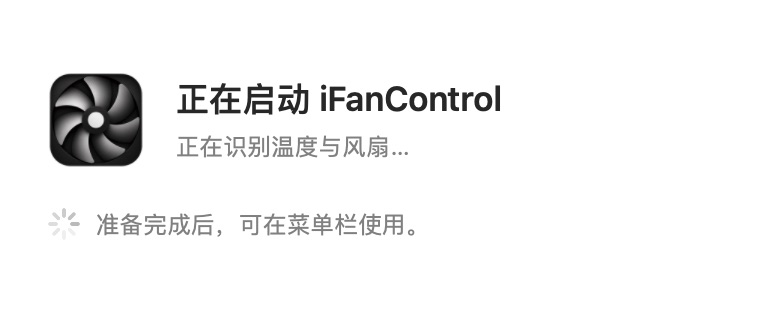

# 启动等待界面：Beta70

2026-10-13。维护者观察到启动等待期间仅有一闪而过的更新完成提示，缺少持续反馈，容易被误认为卡住。

## 真实启动边界

读取原日志证实等待发生在初始化阶段。例如69在08:17:24.636Z开始会话，08:17:32.350Z记录硬件profile（约7.7秒），08:17:34.945Z完成风扇解锁。profile日志之后仍有初始化读取，不能将该日志当完整启动边界。

原流程为硬件识别及初始遥测、硬件配置同步、偏好/自启动同步、菜单栏、风扇解锁、控制循环与后台任务。控制循环仍使用已有2秒间隔与20秒遥测启动宽限；这些规则都有原有理由，本轮不改。

## 当前体验

- 原生轻量面板在硬件探测前显示“正在启动 iFanControl”，带App图标及不确定进度指示器。非模态、非激活，不抢走其他应用的键盘焦点。
- 文案对应实际开始执行的阶段：识别温度与风扇、恢复设置、准备菜单栏与风扇控制。没有假百分比、固定等待或最短展示计时。
- 面板先进入窗口系统并刷新内容，初始化安排在主队列下一轮执行。阶段变更强制刷新标签，原生NSProgressIndicator使用独立线程动画，以覆盖原有同步探测的等待。Apple SDK明确说明usesThreadedAnimation为独立线程行为。
- 菜单栏、解锁调用及控制循环完成初始化，后台任务安排好后立即收起。这里只表示应用初始化完成，不声称每台设备都可控、已完成首轮闭环或已获取每个采样值；无风扇及异常设备继续使用原提示与安全机制。
- “已更新至…”的原有真实版本回执改为面板收起后显示。首次语言、无风扇提示与温度源说明也在这之后，避免覆盖或叠加启动面板。控制循环在首次引导之前已经准备好。
- 退出时停止指示器并收起面板。原生动画及系统颜色沿用平台行为，不增加自定义进度动画。

[中文准备阶段](assets/ui-validation-70/startup-controls-zh-light.jpg)、[英文深色启动](assets/ui-validation-70/startup-en-dark.jpg)、[英文准备阶段](assets/ui-validation-70/startup-controls-en-dark.jpg)、[英文恢复设置](assets/ui-validation-70/startup-preferences-en-dark.jpg)、[启动后更新回执](assets/ui-validation-70/ready-update-en-dark.jpg)。截图使用生产控制器与隔离的演示宿主，阶段由验收快捷键推进；不是运行真实硬件的安装后启动录像。

## 验证与边界

Release、原生控制器回归、真实UpdateService隔离回归通过。新增 `packaging/pkg/test_startup.py` 编译实际AppDelegate/菜单/启动面板，替换硬件I/O、特权命令、功率初始化、匿名网络及弹窗点击，使用独立bundle/配置/日志。覆盖普通、硬件主线程等待6秒、无风扇、解锁失败、待更新build高于当前、首次语言选择六种启动。断言面板在探测前可见，原有控制/菜单/心跳计时器与菜单已存在才关闭，之后才调用回执与引导，未来build回执仍保留。无风扇及首次引导在面板关闭后触发。

实际查看中文浅色/英文深色及阶段切换、原生busy indicator与启动后回执。减少动态效果沿用原生指示器行为，没有增加强制最低展示时间。没有缩短或改变现有硬件探测本身；真实启动时长和系统安装后的表现由维护者从69升级70继续验证。

源代码改动为新增StartupProgressWindow.swift，以及AppDelegate启动展示/延后一轮初始化/结束收尾/退出收尾；MenuBarManager仅将首次引导调用从setup移到ready之后。FanManager、CommandExecutor、硬件读取器、控制循环、安全规则、更新服务、PKG脚本、帮助侧栏/官网、反馈邀请、状态时间和完成勾精确保持69。证据见 `packaging/pkg/output/beta-70/protected-invariants.json` 与source-changes.diff。

Beta70独立发布，正式/旧线路和官网下载维持2.9.9/build52。保留60个旧非Beta-feed资产及相同后端/绑定，公网包逐字节/SHA与feed路由核验见 `packaging/pkg/output/beta-70/verification.json`。未执行安装、真实风扇控制、发送反馈、替换用户/Applications中的应用、正式Release或源码提交/推送。
