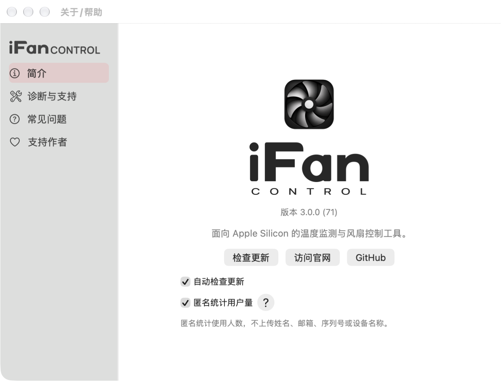
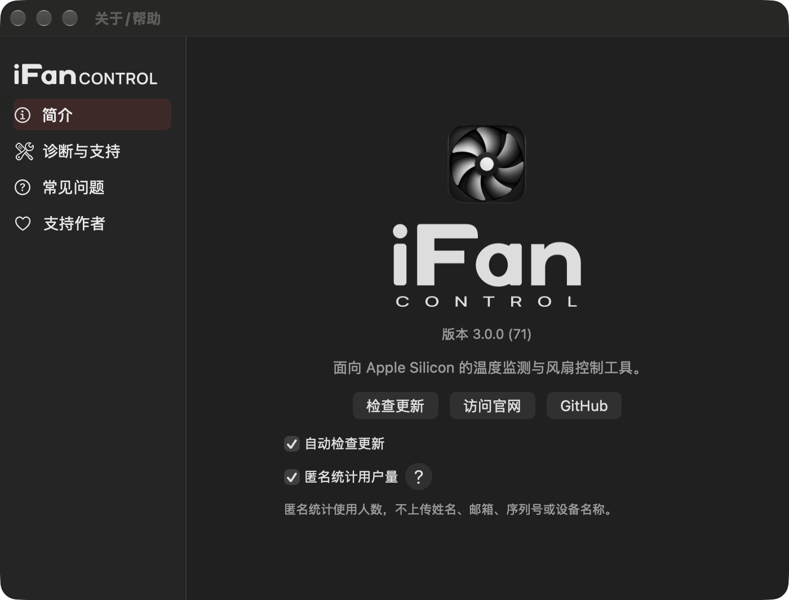

# 软件品牌字标接入（2026-11-05）

本页为初次接入记录，概览长列布局已被维护者否决；当前本地修正版见app-layout-2026-11-05.md。原截图保留供对照。

已将定稿Soft Cast字标接入关于/帮助概览、侧栏和启动面板。概览使用172pt宽堆叠版，侧栏128pt宽横排版，启动面板180pt宽横排版。两个PDF直接拷贝自品牌套件的black版，NSImage作为template使用原生label色，几何与横排底部对齐保持；图标仍为原icon.png。其他窗口正文中的产品名称继续使用系统文本。

SwiftPM资源在Sources/MacFanControl/Resources/Brand，App组装脚本将生成资源bundle放入Contents/Resources。已验证脱离编译目录的App资源查找，两个PDF与原稿字节相同，原图标未变。VoiceOver可读产品名。

本地审查构建：build/brand-review/iFanControl.app。版本元数据沿用源3.0.0/build71，仅作本地审查，不是新发行版。没有替换已安装应用，没有发布App、PKG或更新通道。未来发行需按正常流程递增build。

验证：release构建、ad-hoc严格签名、现有原生界面回归通过；六种启动场景通过，保留启动前展示、真实阶段和结束顺序。真实关于/启动窗口的中英文、浅深色共8张截图均已查看，字标完整、无溢出；浅深色在同一窗口切换以验证适配。所有UI验证采用隔离配置与硬件替身。

复核命令：

```sh
python3 packaging/pkg/test_ui.py --capture-directory packaging/pkg/output/app-brand-20261105
python3 packaging/pkg/test_startup.py --output packaging/pkg/output/app-brand-20261105/startup-regression
python3 scripts/build_app.py --output build/brand-review/iFanControl.app
```

证据与构建哈希：packaging/pkg/output/app-brand-20261105/verification.json。





