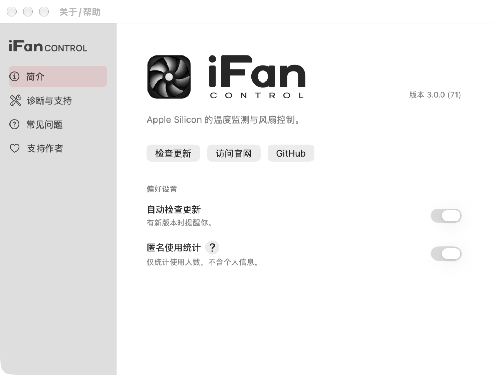
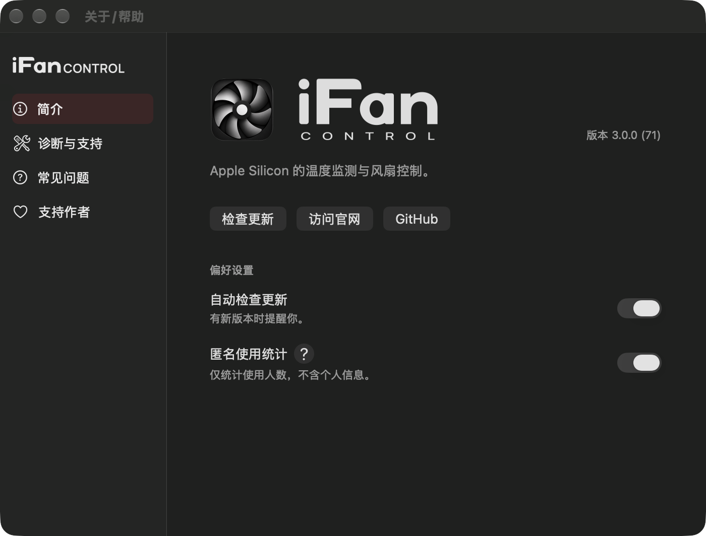
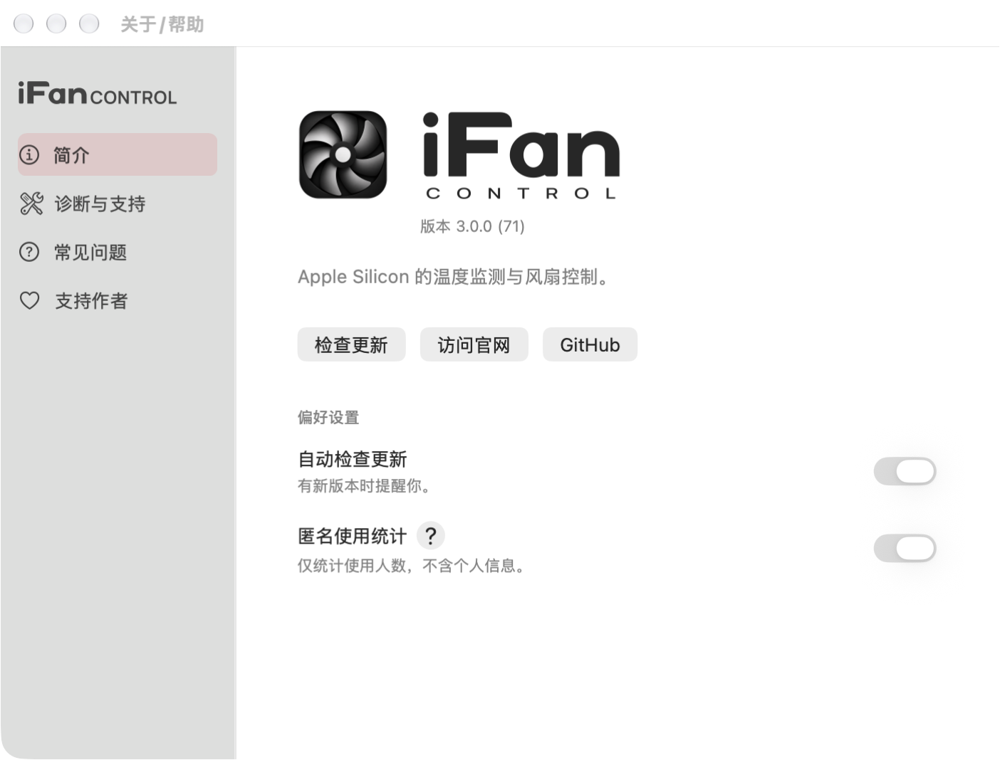
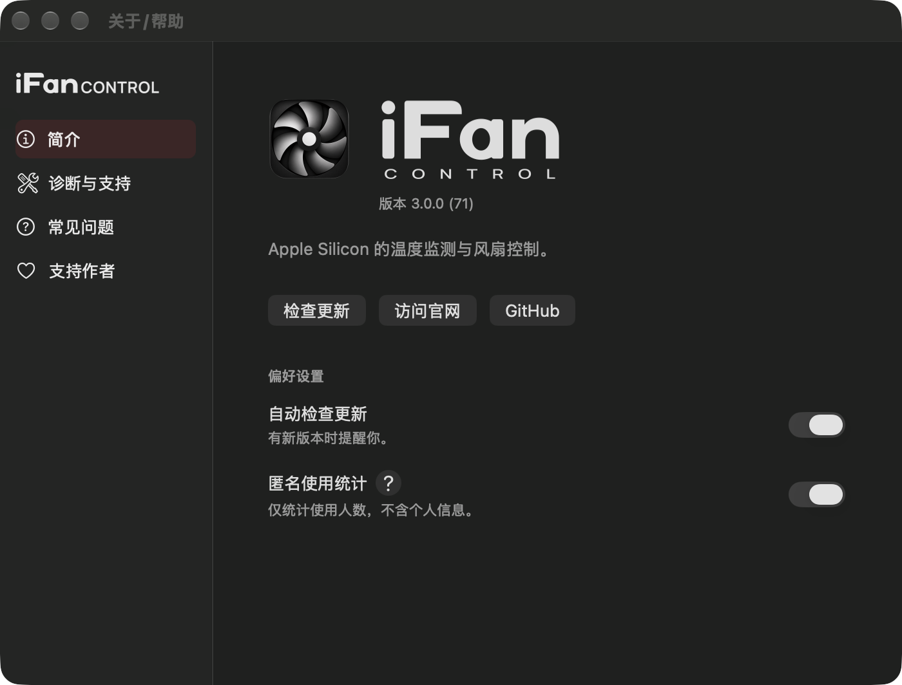
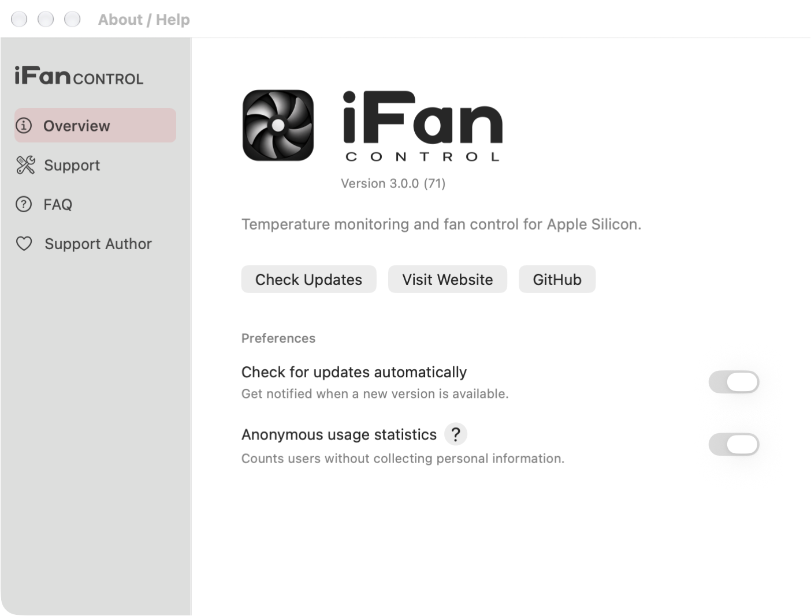
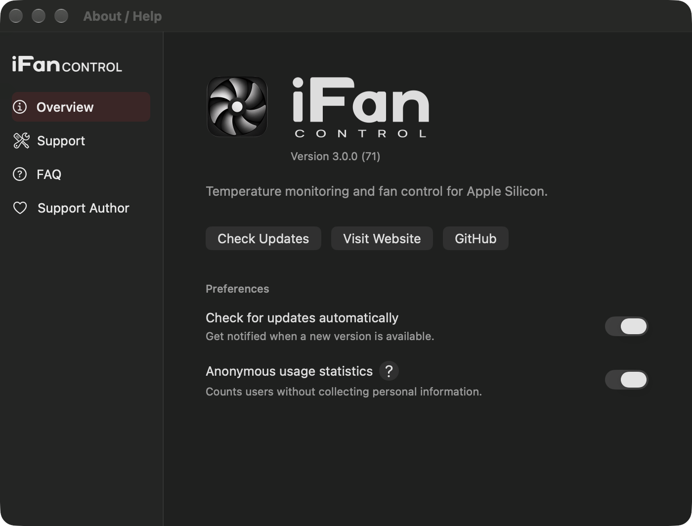

# 关于/帮助窗口排版修整（2026-11-05）

最新微调：维护者要求版本移到右边、图标与字标底部平齐。当前品牌行采用bottom对齐，版本号位于整行右端。下方旧图保留作排版过程记录；最新实拍位于assets/app-brand-align-20261105/，验证记录在packaging/pkg/output/app-brand-align-20261105/。




维护者否决初次字标接入后的居中长列排版。本轮将概览重排为左对齐：64pt原图标与142pt宽堆叠字标并排顶齐，版本号放在字标下；产品描述、操作、偏好设置沿同一左边线。两项偏好改为原生small NSSwitch，沿右边线排列，短描述紧跟各自标题。隐私详情与原有确认行为保留。侧栏紧凑字标112pt，导航13pt/30pt行高，功能导航与开发者解锁保持。

仅改变关于/帮助的呈现及两项控制器的控件类型。更新/隐私偏好仍使用原有服务与动作，图标手势未移除，风扇控制与软件发布线路未改。自动更新开关已通过既有服务的开关保存测试，其他页面切换、开发者模式与原生UI回归均通过。真实窗口浅深色、中英文共4张概览图已查看，无元素裁切或文字重叠；系统窗口仍700×500内容区域，非可缩放窗口。

release构建与ad-hoc严格签名通过。本地审查App：build/brand-review/iFanControl.app。尚未安装或发布，版本元数据3.0.0/build71仅作本地审查。

```sh
python3 packaging/pkg/test_ui.py --capture-directory packaging/pkg/output/app-layout-20261105
python3 scripts/build_app.py --output build/brand-review/iFanControl.app
```

日志与哈希：packaging/pkg/output/app-layout-20261105/verification.json、ui-verification.log、build.log。





