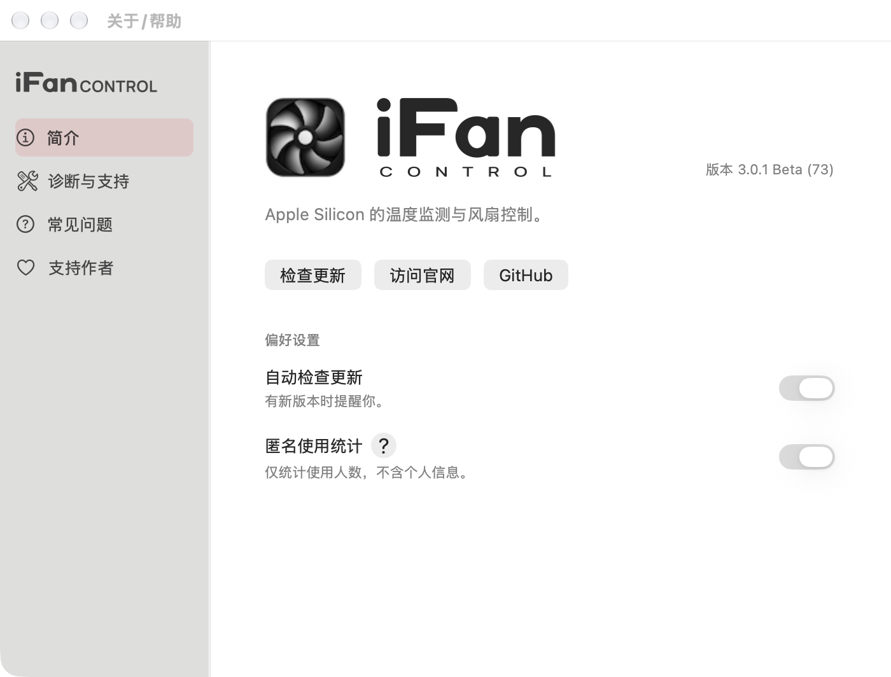
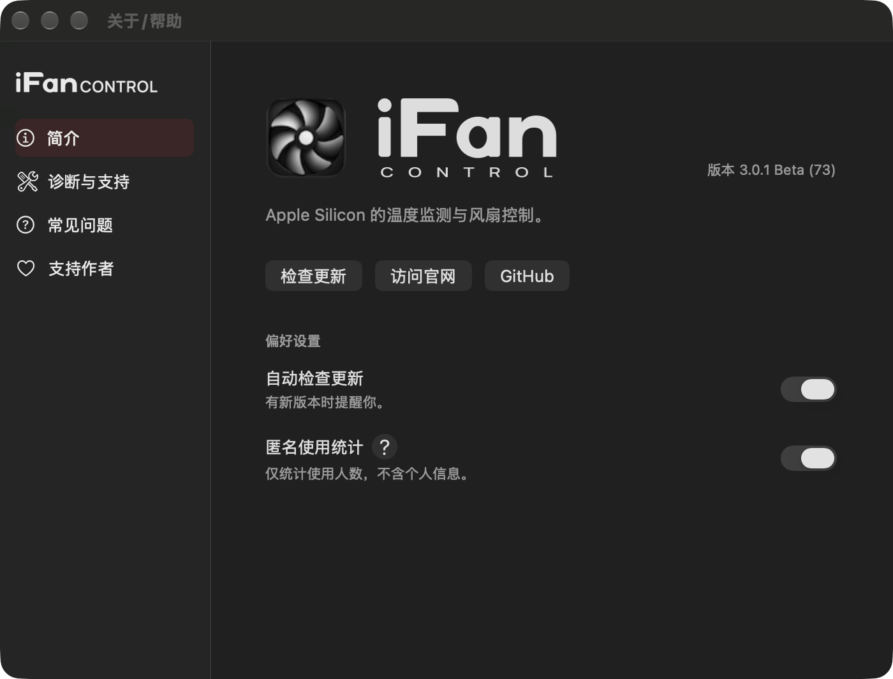

# 完整字标与系统图标可见边缘（Beta73）

维护者在实机Beta72发现，图标上下边缘与完整字标（包括CONTROL）不齐，启动状态窗口也有同样问题。

BrandIdentity现从NSImageView实际绘制结果测量图标可见高度，以完整矢量字标的PDF透明边界计算等比缩放与偏移。堆叠版包含iFan与下方CONTROL，横排版包含全部iFanCONTROL；图标系统留白与阴影不计入可见主体。AppKit bottomAnchor偏移方向按实际渲染校准。预览改用系统生成的应用图标，不再覆盖为原始PNG，避免预览与安装后图标尺寸不一致。

关于页保留64pt图标外框；启动窗口品牌行使用40pt图标外框，真实阶段信息另排在下方，与原生旋转指示器并列。阶段更新、窗口展示与收起时机未改。版本保持在关于页右侧。

Beta73 release构建、安装包展开/签名/脚本校验、原生UI回归和六种实际启动夹具通过。中文和英文浅色截图按完整字标边缘测量：关于页上下偏差0px，启动窗口最多1px（抗锯齿边缘）；深色同一布局已实际查看。测量证据见packaging/pkg/output/beta-73/visible-edge-checks.json。未由助手安装软件。

